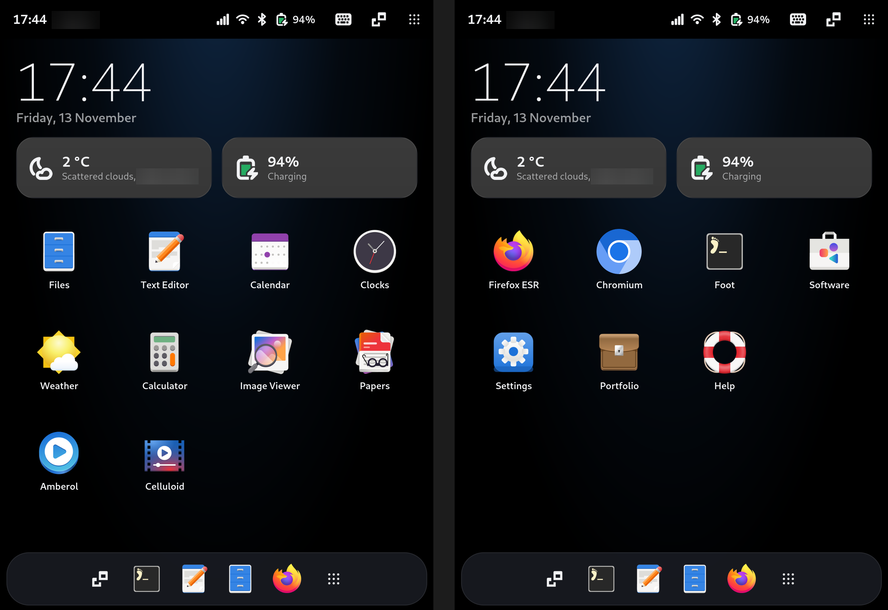
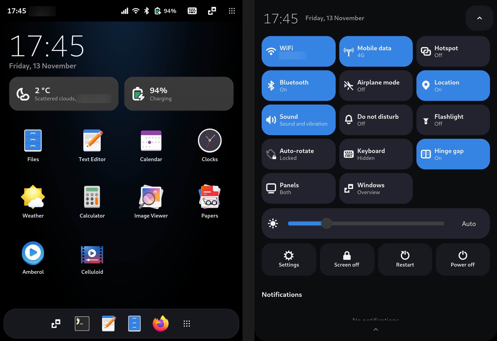
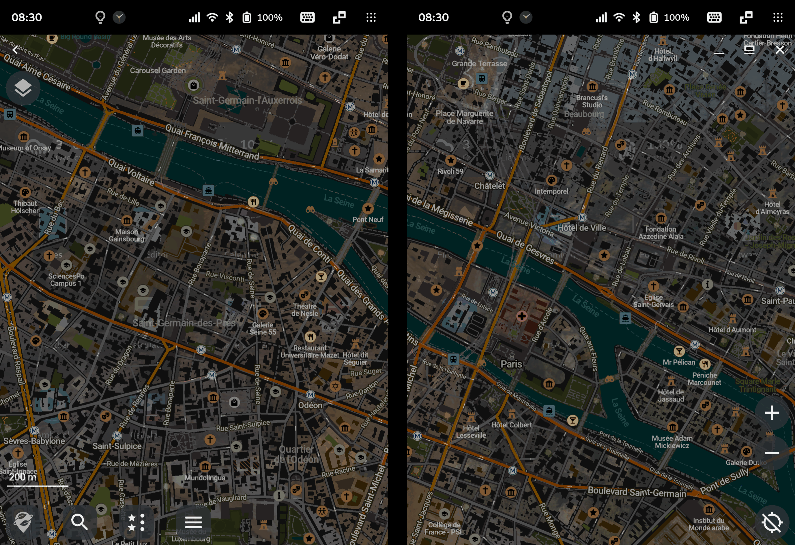
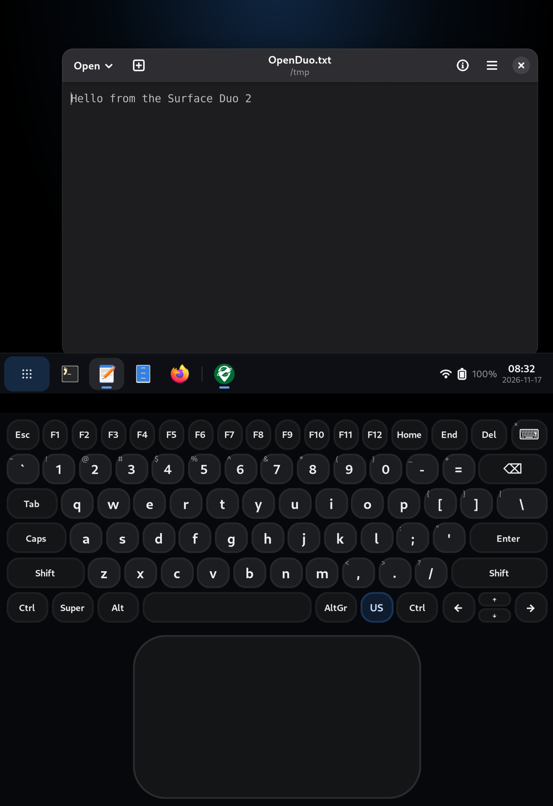

# OpenDuo

OpenDuo is a Linux system for the **Microsoft Surface Duo 2** (Snapdragon 888,
SM8350, codename `zeta`): Debian 13 "trixie" (arm64) on a **mainline Linux
kernel** (7.3.4 plus the patches in [`kernel/patches`](kernel/patches/SERIES.md)),
with its own dual-screen Wayland compositor, a touch-first shell and a
Settings app made for the two panels and the hinge.

It replaces Android on the phone: Android's user data partition becomes
OpenDuo's root, and the stock system partitions stay, so Android can be put
back ([docs/RESTORE.md](docs/RESTORE.md)). It boots through the
[WOA Project](https://github.com/WOA-Project)'s UEFI for the Surface Duo 2 and
systemd-boot. There is no Android kernel and no Android underneath.

> **Status: development preview (0.1.0-dev).** A release image and one script
> on a Linux computer install it ([docs/INSTALL.md](docs/INSTALL.md));
> the image carries no vendor file, the phone's own firmware is read from its
> stock partitions at the first start. Installing wipes the phone. Everything
> in the table below was tested on one phone, the maintainer's.

OpenDuo is not affiliated with, endorsed by or sponsored by Microsoft.
"Surface" and "Surface Duo" are trademarks of the Microsoft group of
companies; they are used here only to say which device OpenDuo runs on.

## Screenshots

Both panels side by side, the dark strip between them is the hinge; in laptop
mode the phone is turned, with the desk panel above the keyboard.

| | |
|---|---|
|  |  |
| Home screen on both panels | The quick menu (right) |
|  |  |
| An Android app (Organic Maps in Waydroid) spanned over both panels; map data © OpenStreetMap contributors | Laptop mode: the upper panel a desk, the lower one a keyboard and touchpad |

## What it is made of

- **Kernel:** Linux 7.3.4 (stable) and 136 patches: the board's device tree,
  a driver for the two panels, WiFi, audio, voice calls, cameras, haptics,
  power management and sleep, the inline crypto engine. 82 of them are
  written to go upstream; the others are marked `BRING-UP:` or are other
  people's posted work ([kernel/patches/SERIES.md](kernel/patches/SERIES.md)).
- **Compositor:** [duo-wc](compositor/duo-wc/README.md), written for this
  phone in Rust on [Smithay](https://github.com/Smithay/smithay): one canvas
  over two panels, windows that snap to a panel or span the hinge, postures,
  rotation, laptop and desktop layouts, screen capture, XWayland.
- **Shell and Settings:** [duo-shell](shell/duo-shell/README.md) and
  [Duo Settings](shell/duo-settings/README.md) (Python, GTK 4, gtk4-layer-shell).
- **System services** for the hardware: touch and pen ([touch/](touch/README.md)),
  sensors and postures ([sensors/](sensors/)), sleep and charging
  ([power/](power/)), modem, calls and SMS ([telephony/](telephony/README.md)),
  hotspot ([hotspot/](hotspot/README.md)), firewall ([firewall/](firewall/README.md)),
  updates and snapshots ([maint/](maint/)), optional encryption
  ([homecrypt/](homecrypt/README.md)), developer mode ([devmode/](devmode/README.md)).
- **Android apps** through [Waydroid](https://waydro.id) ([android/](android/)).
- **Firmware comes from your own phone**, never from this repository or an
  image: the DSP, modem, WiFi, Bluetooth, GPU and video firmware, and
  Microsoft's touch heat-map library (closed source, not redistributable),
  which the touch daemon (adapted from [luma-duo2](https://github.com/none24smu/luma-duo2))
  loads. [`duo2-stock-import`](stock/README.md) reads them from the phone's
  own stock partitions at its first start; the host-side scripts in
  [`scripts/`](scripts/) do the same from Microsoft's recovery image.

## Hardware status

As of 2026-11-17, on the maintainer's phone. **Works**: tested on the phone.
**Partial**: some of it is tested, the notes say what is not. **In
progress**: being worked on, not usable yet. **Not tested**: the code exists
but has not been tried with real hardware. **No**: not available.

| Part | Status | Notes |
|---|---|---|
| Both displays | Works | 1344x1892 AMOLED each, 90 Hz (60 Hz selectable), brightness, each panel on and off on its own; own panel driver |
| Touch | Works | Multi-touch on both panels, one surface across the hinge; uses Microsoft's heat-map library from your phone's image. The digitizer is powered off in sleep and is back about 0.5 s after a wake |
| Pen | Partial | Tested with a Surface Slim Pen 2: pressure, tilt, eraser, palm rejection, the top button over Bluetooth, pen firmware update from Settings. Open: the pen's Bluetooth link can drop when the pen comes near the screen, and hover has gaps. Charging the pen in the cover does not work yet |
| Hinge and postures | Works | Hinge angle and posture from the sensor DSP (book, tent, folded back, closed); opening the phone wakes it |
| Rotation | Works | Per panel, automatic from the accelerometers |
| Other sensors | Works | Accelerometers, gyroscopes, magnetometers, ambient light (automatic brightness) and proximity (the screen goes off at the ear during a call) |
| GPU | Works | Adreno 660 with Mesa freedreno (OpenGL 4.6, OpenGL ES 3.2) and turnip (Vulkan) |
| Hardware video decoding | Partial | H.264 and HEVC in mpv, GStreamer and Pipeline (YouTube). VP9 in hardware crashes the video firmware, so it is decoded in software; the chip has no AV1; browsers decode in software |
| WiFi | Works | 2.4 and 5 GHz, Wi-Fi 6, the factory MAC address, the regulatory country from the mobile network. Off while asleep; wake-on-WLAN is built but off and not tested |
| Bluetooth | Partial | The controller works with its factory address; the pen pairs; headphones play music (A2DP), and the sound moves to them when they connect and back to the speakers when they go. Keyboards are not tested |
| Mobile data | Works | LTE and 5G (NSA); 5G only while a screen is on and WiFi is not connected, to save power |
| Calls | Works | Incoming and outgoing over 2G fallback (CSFB), so the network must still have 2G; earpiece, speakerphone, mute, DTMF, ringtones, do not disturb; a call wakes the phone |
| VoLTE | In progress | The modem talks to our IMS data service, but IMS does not register yet |
| SMS | Works | Send and receive; an SMS wakes the phone. MMS is not set up |
| eSIM | Partial | Profile manager in Settings; reading the eSIM chip works, downloading and using an operator profile is not tested |
| GNSS (GPS) | Partial | The modem's GNSS starts on demand and streams positions; cell and IP location work; a first outdoor fix has not been timed |
| Speakers | Works | Stereo; no speaker protection yet, so the volume is capped |
| Earpiece and microphones | Works | In calls and for recording |
| Cameras | Partial | All four sensors stream (libcamera, software ISP) and photos work; no autofocus or image stabilisation, basic image tuning |
| Flashlight | Works | The rear LED, from the quick menu |
| Vibration | Works | Keys, notifications, calls |
| Charging and battery | Works | USB-C charging, battery level and health, a clean shutdown at 3 % |
| Charge limit | In progress | Microsoft's "Long Life" charge hold is exposed; where the firmware stops charging is not measured yet |
| Sleep | Works | Sleeps by itself when both panels are dark; wakes on the power key, opening the phone, a call, an SMS, an alarm or the charger. Measured standby on battery with LTE: about 2.3 % per hour |
| USB | Works (device mode) | Charging, and device mode to a computer: networking, USB tethering and the serial console, also after the cable is unplugged and plugged in again. No host mode (OTG) and no USB 3 |
| External display | No | The compositor side (a desktop mode or mirroring, chosen on connect) is built; DisplayPort over USB-C is not enabled in the kernel yet |
| Hotspot | Works | The WiFi hotspot works next to the phone's own WiFi connection (a phone connected and browsed); Settings lists the connected devices. USB tethering works too |
| Fingerprint | No | The sensor belongs to the secure world; no realistic path for now |
| NFC | No | Not started |

## What the software does

- **One canvas over two panels.** A window sits on one panel, on half a
  panel, or spans both: drag it by its title bar, or double-tap the title bar
  to span it. The hinge gap can be compensated (lines stay straight across
  it) or switched off.
- **Overview:** swipe up and hold for live cards of the windows on each panel.
- **Phone gestures:** swipe up for the dock, home screen and app grid, down
  for the quick menu, in from the side for back.
- **Postures:** a closed phone shows small glance strips (time,
  notifications, who is calling); tent mode uses the panel you look at;
  folded back uses one panel. The on-screen keyboard opens on the panel you
  type on.
- **Laptop mode** without an external display: one panel becomes a desk
  with a taskbar, the other a keyboard (drawn from your keyboard layout) and
  a touchpad.
- **Shell:** status bars, home screen with widgets, app grid with search,
  quick menu, notifications, lock screen with PIN and emergency calls,
  incoming-call screen, SIM PIN dialog.
- **Duo Settings:** WiFi, Bluetooth, SIM and voicemail, eSIM, hotspot,
  display, appearance, battery usage, sound and ringtones, rotation and
  postures, lock screen and encryption, pen, Android apps, language and
  region, developer options, and an About page with the OpenDuo version.
- **Apps in the image:** GNOME Calls, Chatty (SMS), Contacts, Clocks,
  Weather, Calendar, Files, Text Editor, Firefox ESR, Chromium, Angelfish,
  Celluloid, X11 apps through XWayland, Android apps through Waydroid (every
  app in its own window), and Flatpak with Flathub (tested there: Pipeline
  for YouTube with hardware decoding, and Snapshot for the cameras).
  [Nibfair](apps/nibfair/README.md), a set of pen games, is installed
  separately for now.
- **Security:** a firewall closed by default; SSH only in developer mode,
  with keys only; optional encryption of your home folder tied to the lock
  screen PIN ([homecrypt/](homecrypt/README.md), switched on for the first
  time on the maintainer's phone on 2026-11-16); bug reports with personal
  identifiers masked.
- **Updates:** Settings > Updates installs Debian's updates and OpenDuo's
  own packages from a signed repository (the public one goes live with the
  first release), with a snapshot and a way back before each update; a new
  kernel boots as a trial and the phone falls back to the previous one by
  itself if it does not come up.

Known limits: apps that need Google's Play Integrity (banking and the like)
do not run in Waydroid, and there is no hardware video decoding inside
Android.

## Documentation

- [docs/INSTALL.md](docs/INSTALL.md): the first install, from stock Android.
- [docs/RESTORE.md](docs/RESTORE.md): back to stock Android.
- [CONTRIBUTING.md](CONTRIBUTING.md): building, testing, code standards, pull requests.
- [AGENTS.md](AGENTS.md): the rules for AI coding agents working in this repository.
- [docs/DEVICES.md](docs/DEVICES.md): a proposal for keeping the
  device-specific parts apart, so another device (the original Surface Duo)
  can be added.
- [docs/TODO.md](docs/TODO.md): planned software work.
- [CHANGELOG.md](CHANGELOG.md) and [VERSION](VERSION).
- [kernel/patches/SERIES.md](kernel/patches/SERIES.md): the kernel patch series, patch by patch.
- [docs/SCREENCAST.md](docs/SCREENCAST.md): screen sharing, recording and screenshots.
- [docs/STOCK-KERNEL-GAPS.md](docs/STOCK-KERNEL-GAPS.md): what Microsoft's own
  kernel for the phone has that ours does not yet.
- Every component has its own README (linked above).

## Reporting bugs

Settings > Developer > **Collect a bug report** writes a report with
identifiers masked into Downloads; attach it to the issue
([devmode/README.md](devmode/README.md)). Look through it before you post
it: the masking finds the usual identifiers, not everything a log line may
contain.

## Licenses

- OpenDuo's own code and documentation: **GNU General Public License v3.0 or
  later** (GPL-3.0-or-later, [LICENSE](LICENSE)), unless a file or a directory
  says otherwise.
- [compositor/duo-wc](compositor/duo-wc/): **MIT** ([its LICENSE](compositor/duo-wc/LICENSE)).
- [apps/nibfair](apps/nibfair/): **MIT** ([its LICENSE](apps/nibfair/LICENSE)).
- [touch/](touch/) and `rootfs/overlay/usr/local/sbin/duo2-pend`:
  **Apache-2.0** ([touch/LICENSE](touch/LICENSE)); the touch daemon comes from
  luma-duo2 (none24smu, Apache-2.0).
- A file with its own `SPDX-License-Identifier` line is under that license.
- [kernel/](kernel/): **GPL-2.0**, like the Linux kernel the patches change
  ([kernel/LICENSE](kernel/LICENSE)); patches by other authors keep their
  authors' terms (named in each patch and in SERIES.md).
- Patches to other projects (libcamera, PipeWire, hexagonrpc, libssc,
  diag-router, 81voltd) and the Waydroid test fixture are under the license
  of the project they come from.
- No firmware, vendor library or other Microsoft or Qualcomm file is in this
  repository; the scripts extract them from your own phone's images, for
  your own use.

## Thanks

The [WOA Project](https://github.com/WOA-Project) (the UEFI that makes all of
this bootable), [luma-duo2](https://github.com/none24smu/luma-duo2) (the touch
daemon and boot findings), the [sm8350-mainline](https://gitlab.com/sm8350-mainline/linux)
and postmarketOS people, Microsoft for publishing the Surface Duo 2 kernel
sources and device trees, and everyone upstream whose drivers this builds on.
